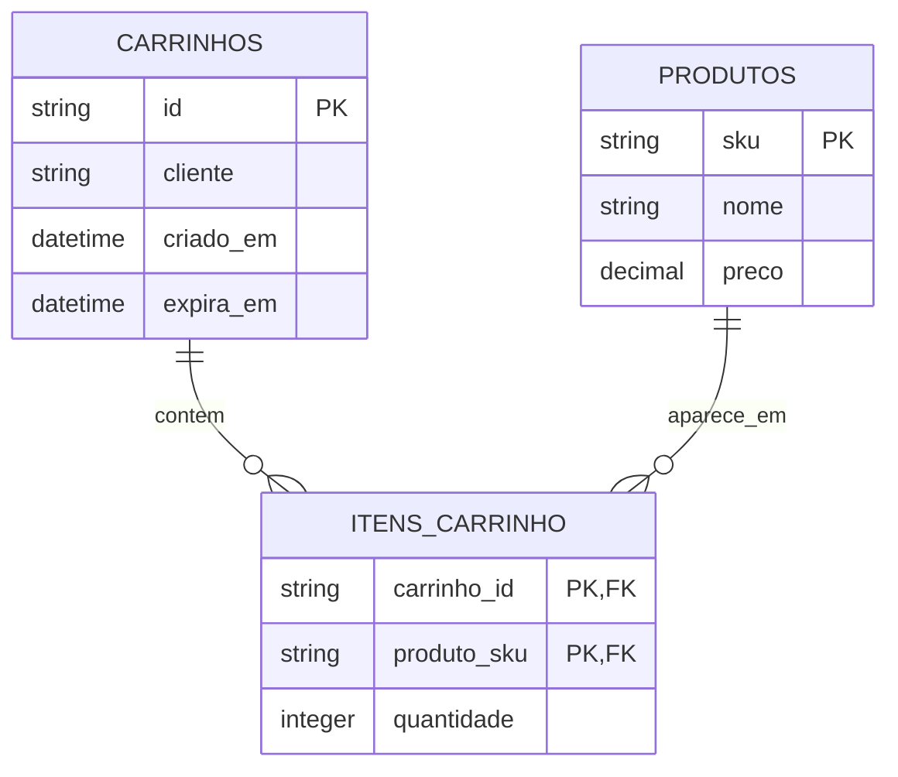

# Modelagem DynamoDB — acesso por carrinho

Tabela única `CarrinhoCompras` com chave composta:

```text
PK           SK          Atributos
CART#001     META        cliente, criadoEm, expiresAt
CART#001     ITEM#P001   sku, nome, preco, quantidade, expiresAt
CART#001     ITEM#P002   sku, nome, preco, quantidade, expiresAt
CART#001     ITEM#P003   sku, nome, preco, quantidade, expiresAt
CART#002     META        ...
```

- `PK` agrupa todos os registros de um carrinho.
- `SK` identifica metadados (`META`) ou cada produto (`ITEM#<sku>`).
- `Query PK = CART#001` traz os itens do carrinho sem varrer a tabela.
- `GetItem PK + SK` busca um item específico.
- `expiresAt` é um timestamp Unix em segundos. No DynamoDB na AWS, TTL habilitado permite exclusão eventual após a expiração. **DynamoDB Local não executa exclusão automática de TTL.**
- O preço e nome do produto são um *snapshot* no carrinho. Não há catálogo normalizado, o que evita JOIN no acesso por carrinho.
- Valores totais são calculados na camada de script após Query; o DynamoDB não faz SUM nesta operação.

## Perguntas e caminhos de acesso

1. Quem é o dono e quando expira o carrinho? `GetItem(PK, META)`.
2. Quais produtos estão no carrinho? `Query(PK)` e filtrar `ITEM#`.
3. Qual é determinado produto do carrinho? `GetItem(PK, ITEM#sku)`.
4. Qual é a quantidade de cada item? `Query(PK)`, selecionar `quantidade`.
5. Quanto custa o carrinho? `Query(PK)` + somar `quantidade * preco` no Node.js.

## Diagrama ER SQL


